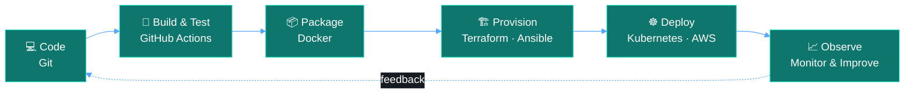

<!-- ═══════════════ HEADER ═══════════════ -->
<div align="center">


<a href="https://github.com/prathap-32">
  
</a>

<br/>

<a href="https://linkedin.com/in/prathap32"></a>
<a href="https://github.com/prathap-32"></a>
<a href="mailto:your-email@example.com"></a>


</div>

<br/>

<!-- ═══════════════ ABOUT (terminal style) ═══════════════ -->
## 🖥️ &nbsp;About

```bash
prathap@devops:~$ cat about.yml
```

```yaml
name:      Prathap G
role:      Aspiring DevOps Engineer
stack:     [Linux, AWS, Docker, Kubernetes, Terraform, Ansible]
mindset:   "Reliable, maintainable, automated"
focus:     Cloud-native deployments · IaC · Observability · Security
status:    Learning in public, shipping small, improving daily
```

I'm an aspiring DevOps engineer with practical experience in **Linux**, **AWS** and **automation**. I build reliable, maintainable infrastructure and automate repeatable workflows to bridge development and operations.

<br/>

<!-- ═══════════════ PIPELINE ═══════════════ -->
## 🔄 &nbsp;How I Ship



<br/>

<!-- ═══════════════ SKILLS ═══════════════ -->
## 🧰 &nbsp;Tech Stack

<div align="center">


<br/>


</div>

<br/>

| Domain | Tools & Practices |
| :-- | :-- |
| 🐧 **Systems** | Linux administration · Bash scripting |
| ⚙️ **CI/CD** | GitHub Actions · pipelines · automated testing |
| ☁️ **Cloud** | AWS — EC2 · S3 · IAM basics |
| 📦 **Containers** | Docker · Kubernetes (fundamentals) |
| 🏗️ **IaC** | Terraform |
| 🤖 **Config Mgmt** | Ansible |
| 🌿 **Collaboration** | Git · branching & pull-request workflows |

<br/>

<!-- ═══════════════ FOCUS ═══════════════ -->
## 🎯 &nbsp;Current Focus

| | |
| :-: | :-- |
| ☁️ | Strengthening cloud-native deployment patterns and IaC practices |
| 🛡️ | Improving infrastructure reliability, observability and security |
| 🔁 | Building reusable automation for developer productivity |

<br/>

<!-- ═══════════════ PROJECTS ═══════════════ -->
## 🚀 &nbsp;Selected Projects

<table>
  <tr>
    <td width="33%" valign="top">
      <h3>🏥 Digital Health Care<br/>Record Management</h3>
      <p>Secure patient data application with containerised deployment.</p>
      <p>
        
        
        
        
      </p>
      <a href="https://github.com/prathap-32/digital-health-care-record-management">View repository →</a>
    </td>
    <td width="33%" valign="top">
      <h3>🗳️ Microservice<br/>Voting App</h3>
      <p>Example microservices and deployment patterns on containers and Kubernetes.</p>
      <p>
        
        
        
      </p>
      <a href="https://github.com/prathap-32/micro-service-voting-app">View repository →</a>
    </td>
    <td width="33%" valign="top">
      <h3>🧪 DevOps Automation<br/>Toolkit</h3>
      <p>Personal scripts and workflows for repeatable operations.</p>
      <p>
        
        
        
      </p>
      <a href="https://github.com/prathap-32">View profile →</a>
    </td>
  </tr>
</table>

<br/>

<!-- ═══════════════ STATS ═══════════════ -->
## 📊 &nbsp;GitHub Snapshot

<div align="center">


</div>

<br/>

<!-- ═══════════════ CONNECT ═══════════════ -->
## 🤝 &nbsp;Let's Connect

I'm open to **DevOps internships, junior roles and collaboration** on automation or cloud projects.

| Channel | Link |
| :-- | :-- |
| 💼 LinkedIn | [linkedin.com/in/prathap32](https://linkedin.com/in/prathap32) |
| 🐙 GitHub | [github.com/prathap-32](https://github.com/prathap-32) |
| ✉️ Email | your-email@example.com |

<div align="center">

<br/>

<sub>⚡ *"Automate the boring stuff, so there's time for the interesting stuff."*</sub>


</div>
